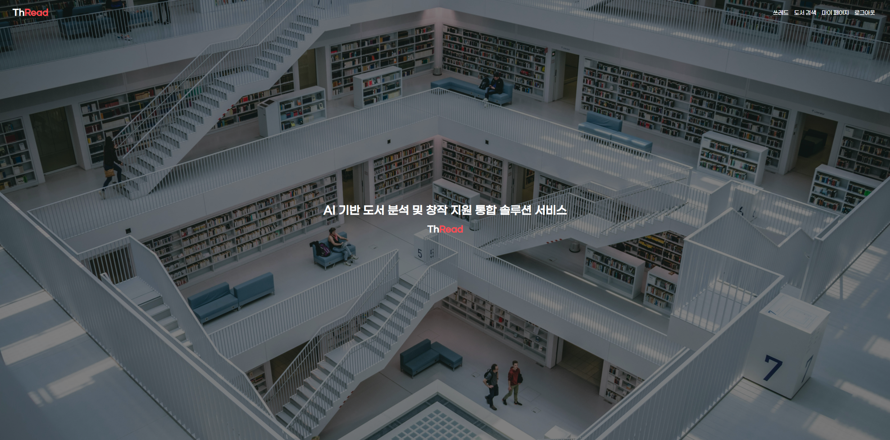
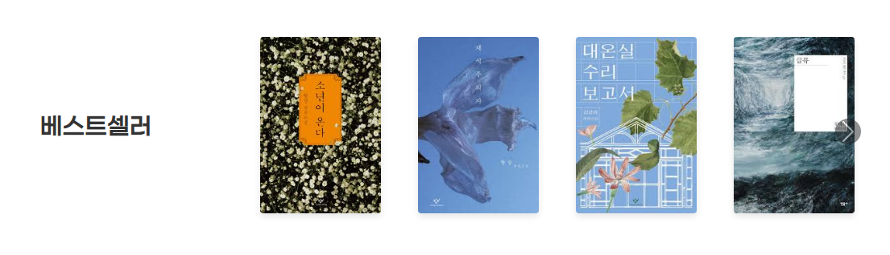

# ThRead – 반응형 웹 페이지 구성 (03-pjt)

AI 기반 도서 분석과 창작 지원 통합 솔루션 서비스 **ThRead**의 메인 페이지를
HTML / CSS / Bootstrap 5.3으로 구현한 프로젝트입니다.
섹션별 스켈레톤(01~05)을 각각 완성한 뒤 하나의 메인 페이지(`06-main`)로 결합했습니다.

---

## 1. 프로젝트 구조

```
skeleton/
├─ assets/
│  ├─ ai_recommendation/   # AI 추천 도서 표지
│  ├─ bestsellers/         # 베스트셀러 도서 표지
│  ├─ fonts/               # SBAggroOTF_L, GmarketSansTTFMedium
│  ├─ genre/               # 장르 대표 이미지
│  ├─ nav/                 # 히어로 배경 이미지
│  └─ threads/             # 쓰레드 카드 이미지
├─ 01-navbar.html / .css          # F301, F302
├─ 02-bestseller.html / .css      # F303
├─ 03-ai_recommendation.html / .css  # F304
├─ 04-genre_list.html / .css      # F305
├─ 05-popular_thread.html / .css  # F306
├─ 06-main.html / 06-main.css     # F307, F308 (결합 + 로그아웃 Modal)
└─ images/                   # README용 실행 화면
```

## 2. 실행 방법

- 별도 빌드 없이 `06-main.html`(또는 각 `0N-*.html`)을 Chrome에서 열면 됩니다.
- HTML과 CSS는 **같은 폴더**에 있어야 하고, 이미지와 폰트는 `assets/` 경로를 그대로 사용합니다.
- Bootstrap 5.3.3은 CDN으로 불러옵니다.

## 3. 요구사항 구현 현황

| 번호 | 내용 | 파일 | 상태 |
|---|---|---|---|
| F301 | Navbar | 01-navbar | 완료 |
| F302 | Hero | 01-navbar | 완료 |
| F303 | Bestseller (Carousel) | 02-bestseller | 완료 |
| F304 | AI Recommendation (Grid) | 03-ai_recommendation | 완료 |
| F305 | Genre List (Flexbox) | 04-genre_list | 완료 |
| F306 | Popular Thread (Card, Pagination) | 05-popular_thread | 완료 |
| F307 | 메인 페이지 결합 | 06-main | 완료 |
| F308 | 로그아웃 확인 Modal | 06-main | 완료 |
| F309~F311 | 심화 과제 | – | 미구현 |

---

## 4. 단계별 구현 기록

### 4-1. Navbar & Hero (F301, F302)

| 576px 이상 | 576px 미만 (토글 메뉴 열림) |
|---|---|
|  |  |

**구현한 것**
- 로고 `ThRead`를 `Th`(흰색)와 `Read`(#fe4a51)로 나눠 색을 다르게 적용하고, 로고와 Hero 제목에 GmarketSansTTFMedium, 메뉴에 SBAggro 폰트를 적용했다.
- `navbar-expand-sm`으로 576px 미만에서 메뉴가 토글 버튼으로 바뀌게 했다.
- Navbar는 `position: absolute`, 배경 투명, `z-index: 1030`으로 Hero 위에 겹쳐 보이게 했다.
- Hero 제목에 `<br class="d-sm-none">`를 넣어 576px 미만에서만 "AI 기반 도서 분석 및" 뒤에서 줄이 바뀌게 했다.

**배운 점**
- Navbar를 배경 이미지 위에 겹치려면 부모(`.hero-section`)에 `position: relative`, Navbar에 `position: absolute`를 줘야 한다는 것을 이해했다.
- Hero 안에서 overlay(`z-index: 1`) → 내용(`z-index: 2`) → Navbar(`z-index: 1030`) 순으로 쌓이는 구조를 직접 설계해 보면서 `z-index`가 쌓임 순서를 정하는 값이라는 감이 생겼다.
- Bootstrap의 breakpoint(sm = 576px, md = 768px, lg = 992px)와 `d-sm-none` 같은 표시 유틸리티 클래스의 의미를 알게 됐다.

---

### 4-2. Bestseller (F303)



**구현한 것**
- 12권을 4권씩 3개 슬라이드로 묶고 `data-bs-ride="carousel"`, `data-bs-interval`로 자동 전환되게 했다.
- 이전 버튼은 `display: none !important`로 숨기고 오른쪽 Next 버튼만 남겼다.
- 모든 표지는 `150px × 220px`로 고정하고 `object-fit: cover`로 비율이 깨지지 않게 했다.
- 제목은 왼쪽(`col-lg-3`), Carousel은 오른쪽(`col-lg-9`)에 배치했다.

**배운 점**
- Carousel은 JS를 거의 쓰지 않고 `carousel-inner` / `carousel-item` 구조와 `data-bs-*` 속성만으로 동작한다는 점이 신기했다.
- `object-fit: cover`를 쓰면 이미지를 고정 크기에 넣어도 찌그러지지 않는다는 것을 배웠다.

---

### 4-3. AI Recommendation (F304)


**구현한 것**
- 섹션 폭 80%에 가운데 정렬, Bootstrap 그리드로 좌측(도서 3권) : 우측(소개 문구) = `col-md-7` : `col-md-5`를 구성했다.
- `align-items-center`로 두 영역을 세로 가운데 정렬했다.
- "활동 데이터 기반"은 `#fe4a51`, SBAggroOTF_L, `1.3rem`으로 강조했다.
- 가운데 책을 다른 두 권보다 크게(`recommendation-book--featured`) 보여 줬다.

**배운 점**
- 12칸 그리드에서 7:5 같은 비율을 클래스 하나로 만들 수 있다는 것을 익혔다.
- 이미지 폭을 `%`로 주고 `max-width`와 `aspect-ratio`를 함께 쓰면 화면이 줄어도 비율이 유지되면서 작아진다는 것을 알게 됐다.

---

### 4-4. Genre List (F305)

| 576px 이상 (4열) | 576px 미만 (1열) |
|---|---|
|  |  |

**구현한 것**
- Flexbox(`display: flex; flex-wrap: wrap; gap: 1rem`)로 한 줄에 4개씩 배치했다.
- 각 아이템은 `flex: 0 0 calc((100% - 3rem) / 4)`로 폭을 고정하고, `aspect-ratio: 3 / 2`로 크기를 유지했다.
- 이미지는 부모를 가득 채우고(`width/height: 100%`, `object-fit: cover`), 장르명은 `position: absolute`로 왼쪽 아래에 겹쳐 놓았다.
- 576px 미만에서는 `flex-basis: 100%`로 1열이 되게 했다.

**배운 점**
- `flex: 0 0 <basis>`가 "늘어나지도 줄어들지도 않고 이 크기로 고정"이라는 뜻임을 이해했다.
- 장르명을 이미지 위에 올리려면 부모에 `position: relative`, 글자에 `position: absolute`를 쓰는 패턴을 익혔다.

---

### 4-5. Popular Thread (F306)

| 576px 이상 (3열) | 576px 미만 (1열) |
|---|---|
|  |  |

**구현한 것**
- Bootstrap Card와 `row-cols-1 row-cols-sm-3`으로 576px 이상 3열, 미만 1열을 구성했다.
- 카드 이미지 높이를 CSS로 200px 고정했고, 카드 본문을 `flex-direction: column`으로 만든 뒤 하단 영역에 `margin-top: auto`를 줘서 작성자·도서명이 **항상 카드 맨 아래**에 오게 했다.
- 도서명 색상은 `#fe4a51`로 지정했다.
- Pagination은 `.thread .pagination .page-link`처럼 선택자를 길게 써서 Bootstrap보다 **명시도를 높이고**, 테두리를 없애고 활성 페이지 번호를 `#fe4a51`로 바꿨다.

**배운 점**
- `row-cols-*`가 카드 개수를 breakpoint별로 쉽게 바꿔 준다는 것을 알게 됐다.
- **CSS 명시도**를 처음으로 제대로 체험했다. 단순히 `.page-link`만 쓰면 Bootstrap에 밀리고, 부모 클래스를 붙여 명시도를 높이면 `!important` 없이 덮어쓸 수 있었다.
- `margin-top: auto`가 flex 컨테이너 안에서 남는 공간을 밀어내서 요소를 맨 아래로 보내는 원리를 이해했다.

---

### 4-6. 메인 페이지 결합 (F307)

| Hero | 쓰레드 섹션 + 푸터 |
|---|---|
|  |  |

**구현한 것**
- 01~05의 콘텐츠를 순서대로 결합해 `06-main.html` / `06-main.css` 하나로 만들었다.
- **디자인 시스템 통일**: 포인트 색, 폰트, 섹션 여백, 80% 폭을 CSS 변수(`:root`)로 한 곳에 모으고 모든 섹션이 같은 변수를 쓰게 했다.
- **중복 정리**: 파일마다 있던 `@font-face`와 `body` 스타일을 하나로 합쳤다. 05번에만 `SBAggro_L`이라는 다른 폰트 이름이 쓰여서 `SBAggroOTF_L`로 통일했다.
- **UX 개선**
  - 섹션 배경을 흰색 / 연한 회색으로 번갈아 두어 구분감을 줬다.
  - 메뉴와 Hero 버튼을 클릭하면 해당 섹션으로 부드럽게 스크롤된다(`scroll-behavior: smooth`).
  - 스크롤하면 나타나는 "맨 위로" 버튼, 푸터를 추가했다.
  - 장르 카드는 hover 시 이미지가 살짝 확대되고, 하단 그라데이션으로 장르명이 어떤 이미지 위에서도 읽히게 했다.
  - 키보드 포커스 표시, `prefers-reduced-motion` 존중, 이미지 `loading="lazy"`를 적용했다.

**배운 점**
- 섹션을 합칠 때는 **클래스 이름 충돌과 중복 스타일**이 가장 큰 문제라는 것을 알게 됐다. 그래서 공통 클래스(`.section`, `.section-inner`, `.section-title`)로 반복되는 규칙을 뽑아내는 작업이 필요했다.
- 색이나 폰트를 변수로 빼 두면, 한 번만 고쳐도 전체 페이지가 같이 바뀐다는 것을 체감했다.
- 화려한 효과를 많이 넣는 것보다, 일관된 여백과 색을 지키는 것이 "하나의 사이트처럼 보이게" 하는 데 더 중요하다는 것을 느꼈다.

**어려웠던 점**
1. **파일 이름 문제로 스타일이 전부 깨졌다.** 파일을 여러 번 내려받으면서 `06-main (4).css`처럼 이름 뒤에 `(4)`가 붙었고, HTML이 찾는 `06-main.css`와 이름이 달라서 CSS가 하나도 적용되지 않았다. 화면이 깨지면 코드보다 **파일 이름과 `<link>` 경로**부터 확인해야 한다는 것을 배웠다.
2. **한글이 음절 중간에서 줄바꿈됐다.** "추천"이 "추 / 천"으로 갈라졌다. 원인은 컬럼 폭을 좁게 제한한 것이었고, `word-break: keep-all`로 띄어쓰기 단위로만 줄이 바뀌게 해서 해결했다. 한글 웹페이지에서는 이 속성이 중요하다는 것을 알게 됐다.
3. **내가 넣은 개선이 명세와 어긋났다.** 처음에는 UX를 생각해서 아래처럼 바꿨는데, 요구사항과 대조해 보니 어긋나 있었다.
   - Navbar를 `fixed`로 바꾸고 스크롤하면 배경색이 변하게 했다. → 명세는 "절대 위치, 투명 배경"이었다.
   - 장르 목록을 5열 Grid로 바꿨다. → 명세는 "Flexbox 4열"이었다.
   - 쓰레드 카드를 태블릿에서 2열로 바꿨다. → 명세는 "3열"이었다.
   - 섹션 폭에 최대 1200px 제한을 넣었다. → 명세는 "80%"였다.

   모두 명세대로 되돌렸다. **"더 좋아 보이는 것"보다 "요구사항에 적힌 것"이 우선**이고, 마지막에는 반드시 명세서와 항목별로 대조해야 한다는 교훈을 얻었다.

---

### 4-7. 로그아웃 확인 Modal (F308)


**구현한 것**
- Navbar의 "로그아웃"에 `data-bs-toggle="modal"`, `data-bs-target="#logoutModal"`을 붙여서 클릭하면 Modal이 열리게 했다.
- Modal 헤더 오른쪽 위에 닫기(X) 버튼(`btn-close`, `data-bs-dismiss="modal"`)을 두었다.
- 본문에 "정말 로그아웃 하시겠습니까?"를 가운데 정렬로 보여 주고, **취소 / 로그아웃** 버튼을 출력했다.
- 취소, 로그아웃, X 버튼과 Modal 바깥 영역 클릭 모두 Modal이 닫힌다. 바깥 클릭은 Bootstrap의 기본 동작(backdrop)이다.

**배운 점**
- Bootstrap Modal은 JS 코드를 직접 쓰지 않고 `data-bs-*` 속성만으로 열고 닫을 수 있다는 것을 배웠다.
- 접근성을 위해 `aria-labelledby`, `aria-label` 같은 속성도 함께 써야 한다는 것을 알게 됐다.
- 모바일에서 토글 메뉴가 열린 상태로 Modal을 열면 겹쳐 보일 수 있어서, 메뉴 항목을 누르면 메뉴가 먼저 접히게 처리했다.

---

## 5. 프로젝트를 마치며

**얻은 것**
- Bootstrap의 Grid, Navbar, Carousel, Card, Pagination, Modal을 한 프로젝트 안에서 모두 써 보면서 "클래스만으로 어디까지 되고, 어디부터 직접 CSS를 써야 하는지"의 경계를 알게 됐다.
- Flexbox, `aspect-ratio`, `object-fit`, `position`, `z-index`, 미디어 쿼리 같은 CSS 핵심 개념을 실제 화면에 적용해 보며 익혔다.
- 명시도, CSS 변수, 클래스 이름 충돌처럼 **혼자 만들 때는 몰랐던 문제를 "합치는 과정"에서 배웠다.**

**아쉬운 점**
- F309~F311(심화 과제: 섹션 재배치, 동적 Grid 레이아웃, 도서 상세 페이지)은 시간 관계상 구현하지 못했다.
- Pagination과 로그아웃은 화면만 구현되어 있고, 실제 데이터와 기능 연동은 다음 단계 과제로 남았다.

**느낀 점**
- 화면이 깨졌을 때 원인은 대부분 코드의 큰 실수가 아니라 **파일 이름, 경로, 명시도, 로드 순서** 같은 작은 부분이었다. 그래서 개발자 도구(F12)로 어떤 파일이 불러와졌는지, 어떤 스타일이 적용되었는지 확인하는 습관이 중요하다는 것을 느꼈다.
- 생성형 AI의 도움을 받으면 작업 속도가 빨라지지만, AI가 만든 코드도 **명세서와 직접 대조해서 검증**해야 한다는 것을 경험했다. 결과를 그대로 믿지 않고 한 번 더 확인하는 태도가 필요하다.
- 처음에는 "예쁘게 만드는 것"에 마음이 갔지만, 결국 요구사항을 정확히 지키고 일관성을 유지하는 것이 더 중요하다는 점을 배웠다.
